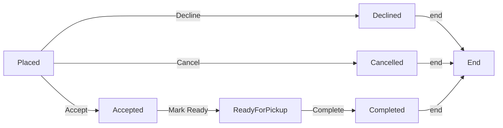
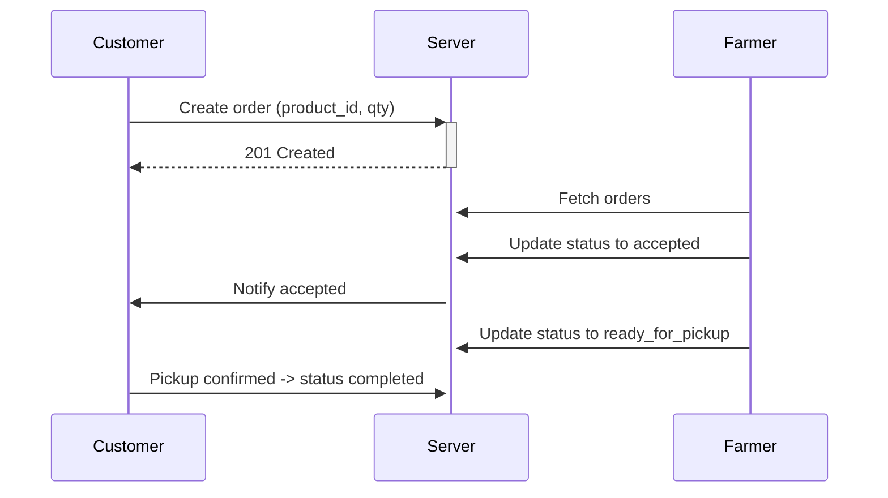

# MarketLink — Producer / Marketplace Platform

## Project Overview

MarketLink is a full-stack marketplace platform that enables small producers (farmers) to list produce, accept pre-orders from customers, and manage inventory and pickups. The system supports role-based access (customer, farmer, admin), social sign-in, spreadsheet-based bulk product import, and strict order lifecycle management.

## Team

- **TEAM TITLE:** WebHub
- **TEAM MEMBERS:**
  - Student1609216 - RAMAN
  - Student1605176 - SOORAJ KUMAR
  - Student1604709 - MEHDI ABBAS MOSANI
  - Student1602673 - ABDUL WASAY KHAN
- **TEAM EMAIL:** webhub@aptechgdn.net
- **TEAM PASSWORD (shared):** WebHub_Techwiz7

## Problem Definition

Small producers and customers need a simple local marketplace to coordinate pre-orders, manage inventory, and record order status transitions reliably. MarketLink solves these problems by:

- Allowing farmers to list and bulk-import products using CSV/XLSX.
- Enforcing strict order state transitions (placed → accepted → ready_for_pickup → completed; and terminal states cancelled/declined/completed).
- Calculating revenue from product price × quantity to ensure financial accuracy.
- Supporting social authentication while preserving user role selection.

## Design Specifications

- Frontend: React + Vite
- Backend: Node.js + Express
- Database: MongoDB (Mongoose ODM)
- Auth: JWT, role-based access control
- File uploads: Multer
- Spreadsheet parsing: xlsx
- Scheduler: recurring stock scheduler service for stock reminders

### Architecture (high-level)

1. Client (React) communicates with Server via REST API (/api/*).
2. Server validates requests, enforces business rules (order state transitions), and persists to MongoDB.
3. File uploads stored under `/uploads` and product import handled by server using `xlsx`.

## Diagrams

Flowchart: Order lifecycle



Sequence: Place order -> Farmer accepts -> Ready -> Complete



Data Flow Diagram (high-level)

```mermaid
graph LR
  A[Client] --> B[API Server]
  B --> C[(MongoDB)]
  B --> D[/Uploads (images, import files)/]
  B --> E[External: Email, Stripe]
```

## Database Design

This is a simplified view of core collections and key fields. Use Mongoose schemas in `Server/Models` for exact structure.

- Users
  - _id, username, email, passwordHash, role (customer|farmer|admin), approvalStatus, contact_number, address
- Products
  - _id, name, category, price (Number), unit, stock_quantity (Number), image_url, Farmer_id (ref Users), is_available
- Orders
  - _id, order_id, customer_id (ref Users), product_id (ref Products), quantity (Number), total_amount (Number), order_status (string), createdAt
- Markets
  - _id, name, location, schedule
- Reviews
  - _id, customer_id, farmer_id, product_id, rating, comment, replies[]

ER Notes:

- `Users` (farmer) 1-to-many `Products`.
- `Products` referenced by `Orders` and `Reviews`.

## Test Data (examples)

Sample Users (use these to sign-in during testing):

- Admin
  - Email: admin@marketlink.test
  - Password: WebHub_Techwiz7
  - Role: admin
- Farmer
  - Email: farmer1@marketlink.test
  - Password: WebHub_Techwiz7
  - Role: farmer
  - approvalStatus: approved
- Customer
  - Email: customer1@marketlink.test
  - Password: WebHub_Techwiz7
  - Role: customer

Sample Product JSON

```json
{
  "name": "Organic Tomatoes",
  "category": "Vegetables",
  "price": 120,
  "unit": "kg",
  "stock_quantity": 75,
  "image_url": "https://example.com/tomatoes.jpg"
}
```

Sample Order JSON

```json
{
  "product_id": "<PRODUCT_ID>",
  "customer_id": "<CUSTOMER_ID>",
  "quantity": 3,
  "total_amount": 360,
  "order_status": "placed"
}
```

## Project Installation Instructions (MANDATORY)

Prerequisites:

- Node.js (v18+ recommended)
- npm (v9+)
- MongoDB (local or Atlas)

1. Clone repository

```bash
git clone <your-repo-url> MarketLink
cd MarketLink
```

2. Server setup

```bash
cd Server
npm install
```

Create a `.env` file in `Server/` (example variables):

```
PORT=5000
MONGODB_URI=mongodb://localhost:27017/marketlink
JWT_SECRET=replace_with_a_secure_secret
EMAIL_HOST=smtp.example.com
EMAIL_USER=you@example.com
EMAIL_PASS=your-email-password
STRIPE_SECRET=sk_test_xxx
```

Start server

```bash
npm run dev
```

3. Client setup

```bash
cd ../Client
npm install
npm run dev
```

Open `http://localhost:5173` (or the URL shown by Vite).

4. Import sample products

- Use the `Download Template` in the Farmer Dashboard or upload a CSV with columns: `name,category,price,unit,stock_quantity,description,image_url`.

## User Credentials for All Types (MANDATORY)

Default test accounts (create these in your database or use the app registration flow):

- Admin
  - Email: admin@marketlink.test
  - Password: WebHub_Techwiz7
- Farmer (approved)
  - Email: farmer1@marketlink.test
  - Password: WebHub_Techwiz7
- Customer
  - Email: customer1@marketlink.test
  - Password: WebHub_Techwiz7

Team contact (for project queries): webhub@aptechgdn.net

> NOTE: These credentials are for development/testing only. Do not use them in production.

## How Revenue Is Calculated

All displayed totals are derived as:

```
revenue = product.price * order.quantity
```

The backend enforces this logic and the frontend uses the same derived value when presenting analytics. If product price or quantity are missing, the system falls back to stored `total_amount`.

## Testing & QA

- Manual testing steps:
  1. Create farmer account and ensure approvalStatus is `approved`.
  2. Add products via dashboard or CSV import.
  3. Place an order as a customer and verify order appears in farmer's Pre-Orders.
  4. Advance order status through allowed transitions and confirm notifications.
  5. Check analytics for revenue alignment (price × quantity).

## Important Files & Folders

- Server/
  - Routes/: API route definitions
  - Controllers/: Business logic and request handlers
  - Models/: Mongoose models
  - Services/: Background tasks and helpers
- Client/
  - src/: React app (components, dashboards, services)
  - public/: static assets

## Troubleshooting

- If frontend fails to load, ensure server is running and CORS origin `http://localhost:5173` is allowed.
- If MongoDB connection fails, verify `MONGODB_URI` in `.env` and that MongoDB is reachable.

## Future Improvements

- Add end-to-end automated tests (Cypress / Playwright).
- Improve email reliability and transactional templates.
- Role-based admin dashboard for approvals and reports.

## License

This project is provided as-is for educational/demo purposes. Modify and adapt as needed for your course submission.

## Acknowledgements

Built by WebHub team for MarketLink demonstration and coursework.
